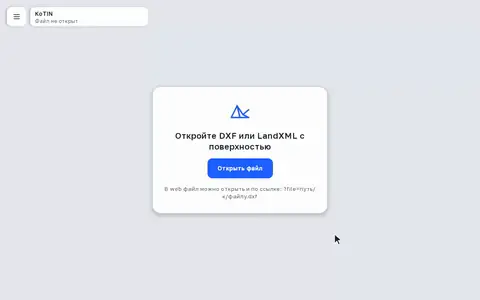
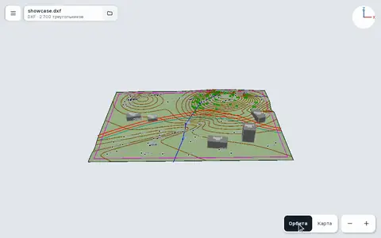
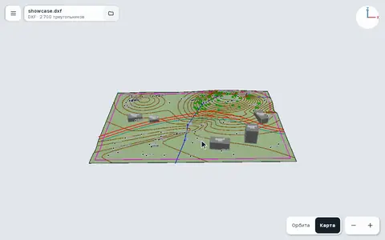
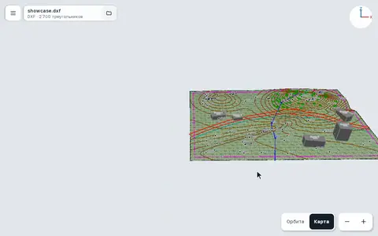
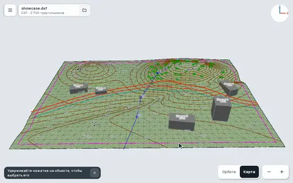
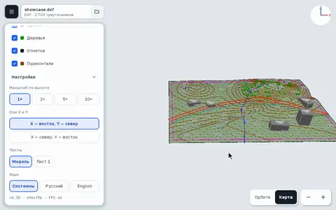
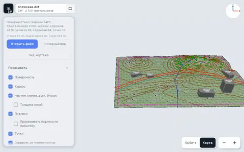
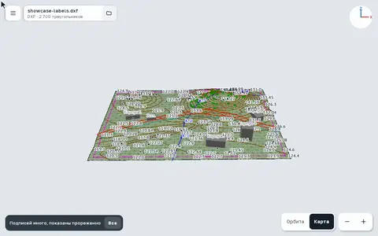

# KoTIN: 3D-просмотрщик DXF и LandXML

[](https://kotlinlang.org/docs/multiplatform.html) [](https://github.com/erkko68/filament-kmp)

     

TIN-поверхности, чертежи, трассы и сети в 3D — на Android, desktop и в браузере. Kotlin Multiplatform, рендер Filament, свой потоковый разборщик DXF и LandXML.

### Запустить

<a href="https://iskandern.github.io/KoTIN/"></a>

Скачать: [Android APK](https://github.com/iskandern/KoTIN/releases/latest/download/KoTIN.apk) · [Windows](https://github.com/iskandern/KoTIN/releases/latest/download/KoTIN-windows.msi) · [macOS](https://github.com/iskandern/KoTIN/releases/latest/download/KoTIN-macos.dmg) (Apple Silicon) · [Linux (deb)](https://github.com/iskandern/KoTIN/releases/latest/download/KoTIN-linux.deb) · [все выпуски](https://github.com/iskandern/KoTIN/releases)

<details open>
<summary><h2>Сравнение с другими реализациями</h2></summary>

Замеры 24.10.2026, MacBook Pro M3 Pro.

<details open>
<summary><h3>DXF</h3></summary>

| Читатель | Язык | Скорость<br>чтения,<br>МБ/с | TIN<br>20,9&nbsp;МБ,<br>мс | Открыто | Поддержано<br>типов |
|---|---|--:|--:|--:|--:|
| **KoTIN** | Kotlin | **464** | **42** | **341/341** | **34/34** |
| [dxf-viewer](https://github.com/vagran/dxf-viewer) | JS | 100 | 190 | 317/341 | 16/34 |
| [dxf-parser](https://github.com/gdsestimating/dxf-parser) | JS | 97 | 196 | 321/341 | 16/34 |
| [dxflib](https://github.com/qcad/qcad/tree/master/src/3rdparty/dxflib) | C++ | 93 | 217 | 327/341 | 18/34 |
| [netDxf](https://github.com/haplokuon/netDxf) | C# | 78 | 362 | 275/341 | 25/34 |
| [libdxfrw](https://github.com/LibreCAD/libdxfrw) | C++ | 63 | 318 | 332/341 | 34/34 |
| [ACadSharp](https://github.com/DomCR/ACadSharp) | C# | 26 | 477 | 336/341 | 31/34 |
| [ezdxf](https://github.com/mozman/ezdxf) | Python | 6,0 | 2 821 | 337/341 | 33/34 |

**KoTIN читает в 4,6 раза быстрее ближайшего и открывает все файлы.** Скорость: 6 синтетических DXF на 70 МБ (TIN, горизонтали, съёмка, план); открываемость: 341 тестовый DXF открытых проектов: R12–R2018, бинарные, битые.

<details>
<summary><b>Какие типы объектов читают</b></summary>

🟢 читает · 🟡 частично · 🔴 нет · ⚪ проверить не удалось. По исходникам, октябрь 2026. В подсчёт идут типы, которые дают изображение, 🟡 тоже; без типов, которым нужны внешние файлы (растр, подложки, шрифты SHX).

**Библиотеки — разбирают в модель**

| Тип | **KoTIN** | [libdxfrw](https://github.com/LibreCAD/libdxfrw) | [ezdxf](https://github.com/mozman/ezdxf) | [ACad&shy;Sharp](https://github.com/DomCR/ACadSharp) | [netDxf](https://github.com/haplokuon/netDxf) | [dxflib](https://github.com/qcad/qcad/tree/master/src/3rdparty/dxflib) | [dxf-parser](https://github.com/gdsestimating/dxf-parser) | [dxf-viewer](https://github.com/vagran/dxf-viewer) |
| --- | :-: | :-: | :-: | :-: | :-: | :-: | :-: | :-: |
| LINE | 🟢 | 🟢 | 🟢 | 🟢 | 🟢 | 🟢 | 🟢 | 🟢 |
| XLINE / RAY | 🟢 | 🟢 | 🟢 | 🟢 | 🟢 | 🟢 | 🔴 | 🔴 |
| POINT | 🟢 | 🟢 | 🟢 | 🟢 | 🟢 | 🟢 | 🟢 | 🟢 |
| CIRCLE / ARC | 🟢 | 🟢 | 🟢 | 🟢 | 🟢 | 🟢 | 🟢 | 🟢 |
| ELLIPSE | 🟢 | 🟢 | 🟢 | 🟢 | 🟢 | 🟢 | 🟢 | 🟢 |
| SPLINE | 🟢 | 🟢 | 🟢 | 🟢 | 🟢 | 🟢 | 🟢 | 🟢 |
| LWPOLYLINE | 🟢 | 🟢 | 🟢 | 🟢 | 🟢 | 🟢 | 🟢 | 🟢 |
| POLYLINE 2D/3D | 🟢 | 🟢 | 🟢 | 🟢 | 🟢 | 🟢 | 🟢 | 🟢 |
| POLYLINE polyface, mesh | 🟢 | 🟢 | 🟢 | 🟢 | 🟢 | ⚪ | 🟢 | 🟢 |
| 3DFACE | 🟢 | 🟢 | 🟢 | 🟢 | 🟢 | 🟢 | 🟢 | 🟢 |
| SOLID / TRACE | 🟢 | 🟢 | 🟢 | 🟢 | 🟢 | 🟢 | 🟡 | 🟡 |
| TEXT | 🟢 | 🟢 | 🟢 | 🟢 | 🟢 | 🟢 | 🟢 | 🟢 |
| MTEXT | 🟢 | 🟢 | 🟢 | 🟢 | 🟢 | 🟢 | 🟢 | 🟢 |
| ATTRIB / ATTDEF | 🟢 | 🟢 | 🟢 | 🟢 | 🟢 | 🟡 | 🟡 | 🟡 |
| INSERT (+ MINSERT) | 🟢 | 🟢 | 🟢 | 🟢 | 🟢 | 🟢 | 🟢 | 🟢 |
| HATCH | 🟢 | 🟢 | 🟢 | 🟢 | 🟢 | 🟢 | 🔴 | 🟢 |
| MPOLYGON | 🟢 | 🟢 | 🟢 | 🔴 | 🔴 | 🔴 | 🔴 | 🔴 |
| DIMENSION | 🟢 | 🟢 | 🟢 | 🟢 | 🟢 | 🟢 | 🟢 | 🟢 |
| ARC_DIMENSION, LARGE_RADIAL | 🟢 | 🟢 | 🟢 | 🟡 | 🟡 | 🔴 | 🔴 | 🔴 |
| LEADER | 🟢 | 🟢 | 🟢 | 🟢 | 🟢 | 🟢 | 🔴 | 🔴 |
| MULTILEADER (MLEADER) | 🟢 | 🟢 | 🟢 | 🟢 | 🔴 | 🔴 | 🟢 | 🔴 |
| TOLERANCE | 🟢 | 🟢 | 🟢 | 🟢 | 🟢 | 🔴 | 🔴 | 🔴 |
| MLINE | 🟢 | 🟢 | 🟢 | 🟢 | 🟢 | 🔴 | 🔴 | 🔴 |
| ACAD_TABLE | 🟢 | 🟢 | 🟡 | 🟢 | 🟡 | 🔴 | 🔴 | 🔴 |
| MESH (SubD) | 🟢 | 🟢 | 🟢 | 🟢 | 🟢 | 🔴 | 🔴 | 🔴 |
| HELIX | 🟢 | 🟢 | 🟢 | 🔴 | 🔴 | 🔴 | 🔴 | 🔴 |
| WIPEOUT | 🟢 | 🟢 | 🟢 | 🟢 | 🟢 | 🔴 | 🔴 | 🔴 |
| OLE2FRAME | 🟡 | 🟢 | 🟢 | 🟢 | 🔴 | 🔴 | 🔴 | 🔴 |
| 3DSOLID, REGION, BODY | 🟡 | 🟡 | 🟢 | 🟡 | 🔴 | 🔴 | 🔴 | 🔴 |
| SURFACE (все виды) | 🟡 | 🟢 | 🟡 | 🟡 | 🔴 | 🔴 | 🔴 | 🔴 |
| ACAD_PROXY_ENTITY | 🟢 | 🟢 | 🟢 | 🟢 | 🔴 | 🔴 | 🔴 | 🔴 |
| Неизвестная, с графикой прокси | 🟢 | 🟡 | 🟡 | 🟡 | 🔴 | 🔴 | 🔴 | 🔴 |
| VIEWPORT (листы) | 🟢 | 🟢 | 🟢 | 🟢 | 🟢 | 🔴 | 🔴 | 🔴 |
| ARCALIGNEDTEXT, RTEXT | 🟡 | 🟢 | 🔴 | 🔴 | 🔴 | 🟡 | 🔴 | 🔴 |
| ***Формат файла*** |  |  |  |  |  |  |  |  |
| Бинарный DXF | 🟢 | 🟢 | 🟢 | 🟢 | 🟢 | 🔴 | 🔴 | 🔴 |
| R12 и старше | 🟢 | 🟢 | 🟢 | 🟢 | 🔴 | 🟢 | ⚪ | ⚪ |
| Кодировка из `$DWGCODEPAGE` | 🟢 | 🟢 | 🟢 | 🟢 | 🟢 | 🔴 | 🔴 | 🟡 |

</details>

</details>

<details open>
<summary><h3>LandXML</h3></summary>

| Читатель | Язык | Скорость<br>чтения,<br>МБ/с | TIN<br>6,0&nbsp;МБ,<br>мс | Открыто | Эталон | Поддержано<br>разделов |
|---|---|--:|--:|--:|--:|--:|
| **KoTIN** | Kotlin | **208** | **14** | **95/95** | **108/108** | **10/10** |
| [npm landxml](https://github.com/abrman/landxml) | JS | 166 | 47 | 49/95 | 69/108 | 1/10 |
| [CivilCraft](https://github.com/getcadcraft/civilcraft) | JS | 83 | 79 | 95/95 | 90/108 | 6/10 |
| [mac999/landxml_parser](https://github.com/mac999/landxml_parser) | Python | 36 | 80 | 95/95 | 37/108 | 1/10 |
| [LandXML2glTF](https://github.com/nathancrews/LandXML2glTF) | C++ | 10 | 670 | 69/95 | 31/108 | 5/10 |

**KoTIN читает быстрее всех, и только у него всё совпало с эталоном.** 95 файлов: образцы landxml.org и тесты KoTIN; эталон — 71 поверхность и 37 файлов с трассами, разобранные через lxml.

<details>
<summary><b>Какие разделы читают</b></summary>

| Раздел LandXML | **KoTIN** | [CivilCraft](https://github.com/getcadcraft/civilcraft) | [mac999/<br>landxml_parser](https://github.com/mac999/landxml_parser) | [npm landxml](https://github.com/abrman/landxml) | [LandXML2glTF](https://github.com/nathancrews/LandXML2glTF) |
|---|:-:|:-:|:-:|:-:|:-:|
| Surfaces (TIN, grid) | 🟢 | 🟡 только TIN | 🔴 | 🟡 только TIN | 🟢 |
| Alignments | 🟢 спирали, профили, поперечники | 🟡 без спиралей | 🟢 | 🔴 | 🟡 ломаные |
| CgPoints | 🟢 | 🟢 | 🔴 | 🔴 | 🟢 |
| Parcels | 🟢 | 🔴 | 🔴 | 🔴 | 🔴 |
| PlanFeatures | 🟢 | 🟢 | 🔴 | 🔴 | 🟢 |
| PipeNetworks | 🟢 | 🟢 | 🔴 | 🔴 | 🔴 |
| Survey | 🟢 | 🔴 | 🔴 | 🔴 | 🔴 |
| Monuments | 🟢 | 🔴 | 🔴 | 🔴 | 🔴 |
| Roadways | 🟢 | 🔴 | 🔴 | 🔴 | 🔴 |
| CoordinateSystem | 🟡 показывает, не пересчитывает | 🟢 | 🔴 | 🔴 | 🟢 |

</details>

</details>

</details>

<details open>
<summary><h2>Как пользоваться</h2></summary>

<p><b>Открыть файл</b><br>≡ → «Открыть файл» или кнопка на пустом экране. Android: из файлового менеджера «Открыть с помощью» → KoTIN. Web: ссылка <code>?file=путь/к/файлу.dxf</code>.<br clear="left"></p>

<p><b>Камера «Орбита»</b><br>Переключатель «Орбита | Карта» — справа внизу. Палец вращает, два пальца сдвигают, щипок — зум. Мышь: <kbd>ЛКМ</kbd> вращает, <kbd>ПКМ</kbd> сдвигает, колесо — зум.<br clear="left"></p>

<p><b>Камера «Карта»: сдвиг и зум</b><br>Палец или <kbd>ЛКМ</kbd> сдвигает (с инерцией), щипок или колесо — зум к курсору.<br clear="left"></p>

<p><b>Камера «Карта»: поворот и наклон</b><br>Два пальца поворачивают, движение двумя пальцами вверх-вниз наклоняет. Мышь: <kbd>ПКМ</kbd> поворачивает, <kbd>Shift</kbd>+<kbd>ЛКМ</kbd> вверх-вниз наклоняет.<br clear="left"></p>

<p><b>Вернуть вид</b><br>Если чертёж ушёл за край экрана, указатель «Чертёж · N м» ведёт к нему. В меню ≡ — «Вид чертежа» (сохранённый в файле) и «Исходный вид».<br clear="left"></p>

<p><b>Слои</b><br>Клик по слою скрывает или показывает его; «Все» / «Ни одного» — для всех сразу. Цвет квадратика — цвет слоя в сцене.<br clear="left"></p>

<p><b>Выбор объекта</b><br>Удерживайте нажатие на объекте — откроется карточка со свойствами. «Рядом ещё объекты» ‹ › перебирает соседей, × снимает выбор.<br clear="left"></p>

<p><b>Оси X и Y</b><br>В «Настройках»: «X — восток, Y — север» или «X — север, Y — восток» (как в геодезии).<br clear="left"></p>

<p><b>Что показывать</b><br>Поверхность, каркас, чертёж, подписи, точки; «Скрывать за поверхностью», «Чертёж в плоскость (без отметок)»; масштаб по высоте 1×–10× в «Настройках».<br clear="left"></p>

<p><b>Подписи</b><br>Когда подписей много, они прореживаются по масштабу: чем дальше камера, тем их меньше; приблизьте — появятся все. Включается само или в меню «Прореживать подписи по масштабу».<br clear="left"></p>

</details>

## Сборка

<details>
<summary><b>Установка и сборка</b> — desktop, Android, web, тесты</summary>

Нужен JDK 24 (toolchain демона — `gradle/gradle-daemon-jvm.properties`).

```sh
./gradlew :app:run --args="путь/к/файлу.dxf" # desktop (JDK 22+, FFM-биндинги Filament)
./gradlew :androidApp:installDebug         # Android
./gradlew :app:wasmJsBrowserDistribution   # web → app/build/dist/wasmJs/productionExecutable
./gradlew :app:jvmTest                     # тесты
```

- **Android:** файл — кнопкой в приложении или из файлового менеджера «Открыть с помощью» → KoTIN.
- **Web:** папку сборки раздать любым статическим сервером; файл по ссылке — `index.html?file=dxf/X.dxf` или `#dxf/X.dxf`.
  Симлинки на свои данные в папку сборки не класть: Gradle при пересборке удалит файлы по ссылке.

</details>

## Тесты

<details>
<summary><b>Запуск тестов и тестовые файлы</b></summary>

```sh
./gradlew :app:jvmTest                                    # все тесты
./gradlew :app:jvmTest --tests '*DxfHatchTest*'           # один класс
LANDXML_BIG=1 ./gradlew :app:jvmTest --tests '*LandXmlLoadTest*'   # нагрузочные: крупный TIN, PntList на 100 МБ
```

Нагрузочные тесты без `LANDXML_BIG=1` пропускаются; `LANDXML_JFR=1` дополнительно пишет профиль JFR.

Тестовые файлы лежат в репозитории (`app/src/jvmTest/resources`) и собираются генераторами из `scripts/`:

```sh
python3 -m venv .venv && .venv/bin/pip install ezdxf
.venv/bin/python scripts/gen_test_dxf.py      # DXF → app/src/jvmTest/resources/dxf/tasks
python3 scripts/gen_test_landxml.py           # LandXML → app/src/jvmTest/resources/landxml/synthetic
```

Генераторы детерминированы: пересоздание файлов не даёт изменений в git.

</details>
